# Demo: every feature, start to finish

Screenshots in [`docs/demo/`](docs/demo) were captured by [`scripts/demo/record.mjs`](scripts/demo/record.mjs),
which drives the real running app (no mock data in the screenshots). Re-run it any time to refresh them.

## Run it yourself

```bash
# .env (see README step 0) plus these demo values:
#   SEED_DEMO_DATA=true  DEMO_DOCTOR_PASSWORD=<pick one>  ADMIN_EMAIL=admin@demo.test  ADMIN_PASSWORD=<12+ chars>
cd ml-service && .venv/bin/python -m uvicorn app:app --port 8000          # 1. ML service
cd backend && mvn spring-boot:run > /tmp/backend.log 2>&1                 # 2. API (emails go to the log)
cd frontend && npm start                                                  # 3. UI on http://localhost:4200

cd scripts/demo && npm install
BACKEND_LOG=/tmp/backend.log ADMIN_PASSWORD=<same as above> node record.mjs   # 4. replays the whole tour
```

Without `ANTHROPIC_API_KEY` the chat runs in scripted **demo mode** (clearly labelled in the UI). Set the key for real Claude replies.

## The tour

### 1. Accounts: sign up and verify email
Patients register themselves (doctors cannot). Until the emailed link is used, a banner explains what is locked.

| | |
|---|---|
| 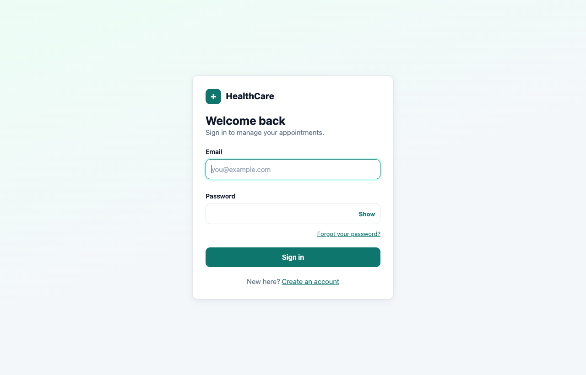 | 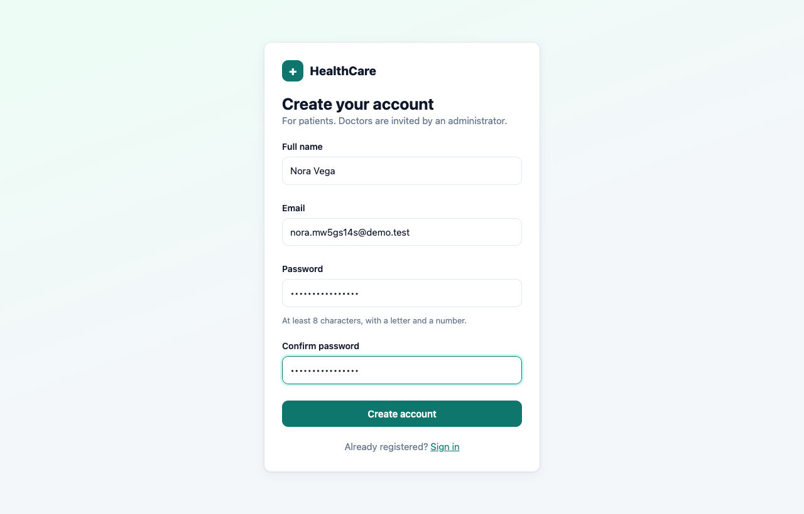 |
|  | 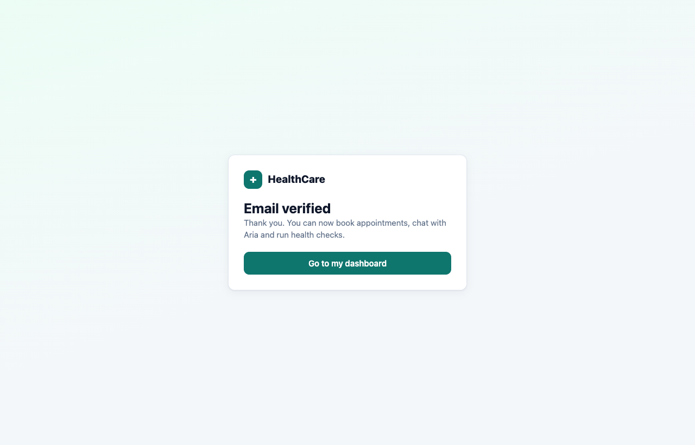 |

### 2. Find a doctor (ML recommender)
Free-text symptoms go to a Python model that predicts the specialty; real doctors are ranked by it.
Emergency wording ("crushing chest pain") is caught by plain rules, not ML, and shows a warning instead of doctors.

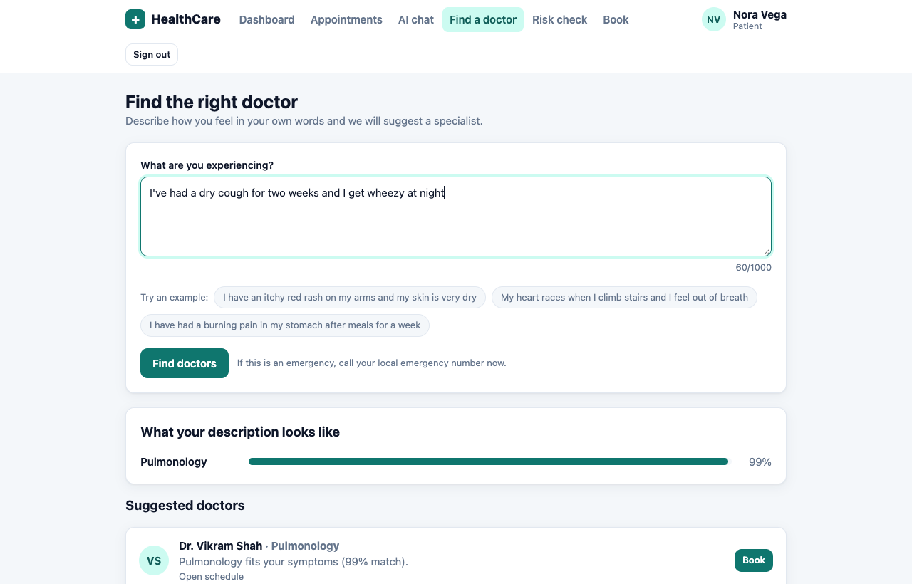
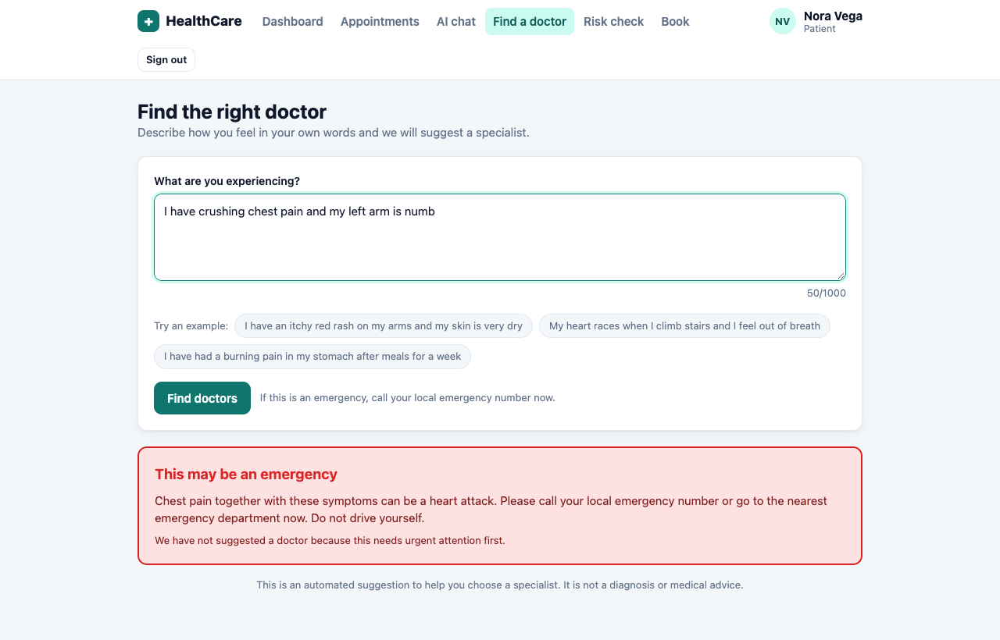

### 3. Diabetes risk check
A model trained on the public Pima dataset returns a score and shows which inputs pushed it up or down.
Results are saved (encrypted at rest) and can be deleted.


### 4. Chat with Aria
Streaming replies over Server-Sent Events, a stop button, retry on error, and an emergency override.


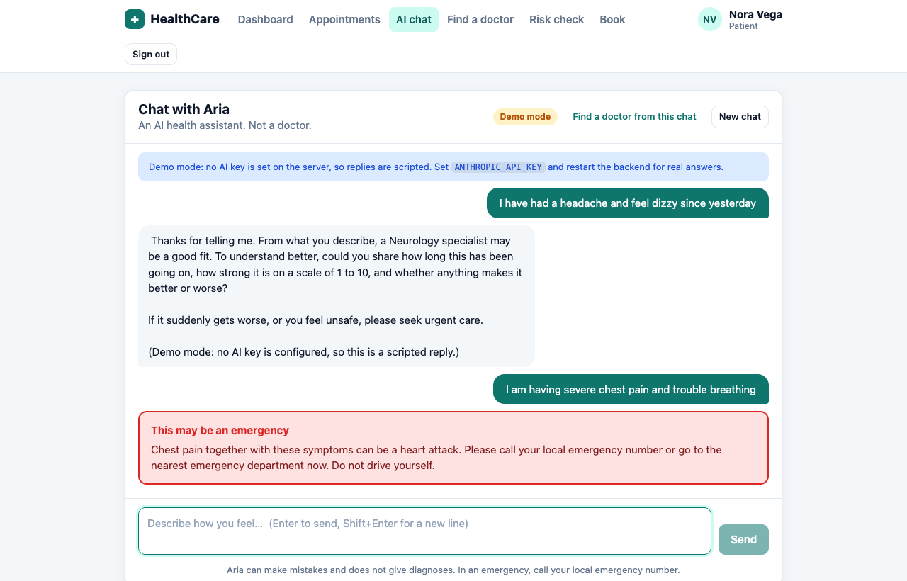

### 5. Appointments: book, list, reschedule
Double-booking is blocked by a database constraint. Lists are paged and filterable.

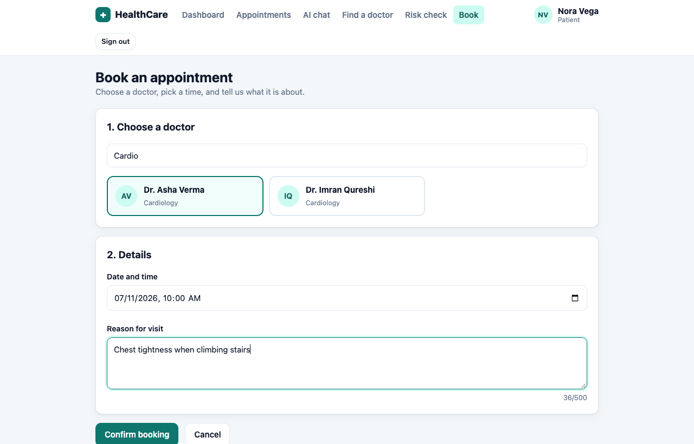
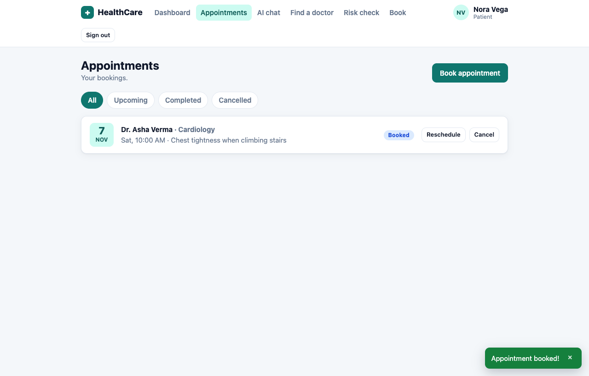
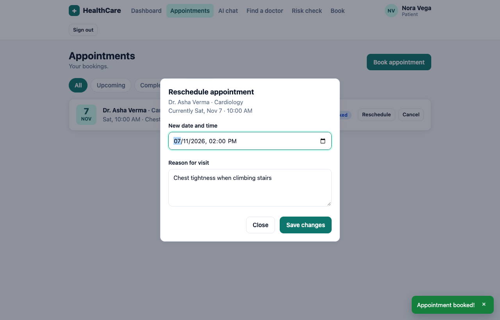
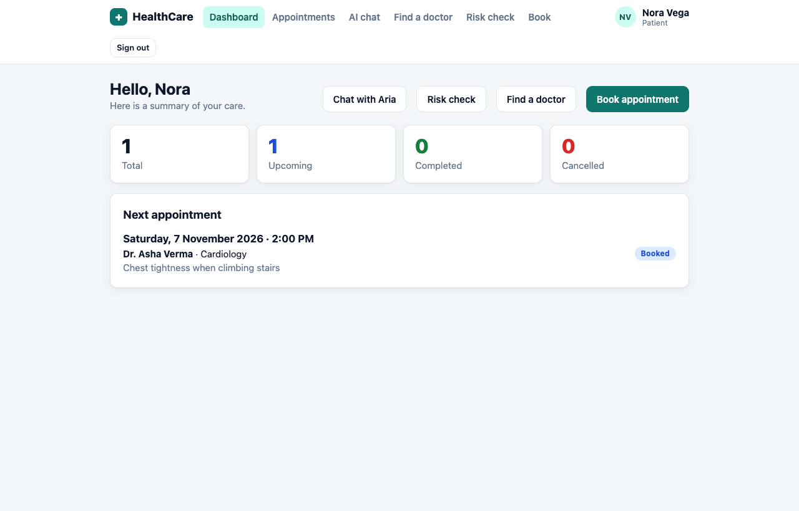

### 6. Forgot and reset password
The response is identical whether or not the email exists; the link works once, and a reset signs out every session.


### 7. Brute-force protection
Repeated wrong passwords lock that account and address pair for 15 minutes.

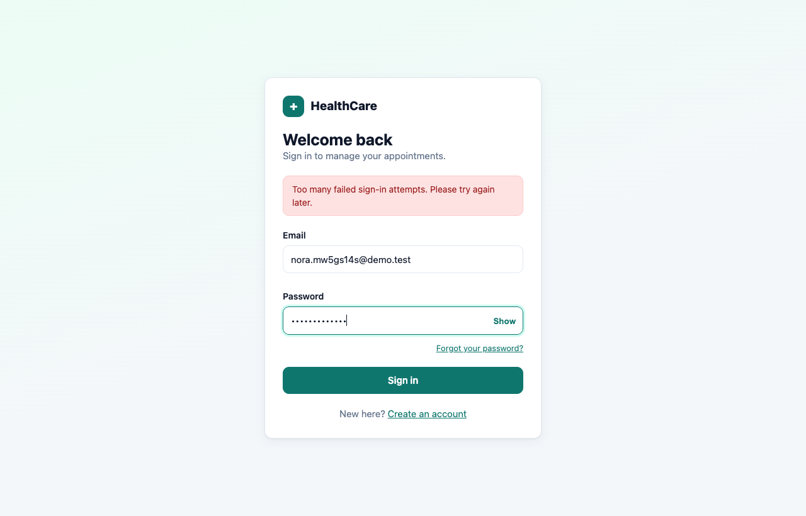

### 8. Admin manages doctors
An admin (created from `ADMIN_*` env vars) adds a doctor, who gets an invite email to set their own password.
Deactivating a doctor ends their sessions and hides them from booking.


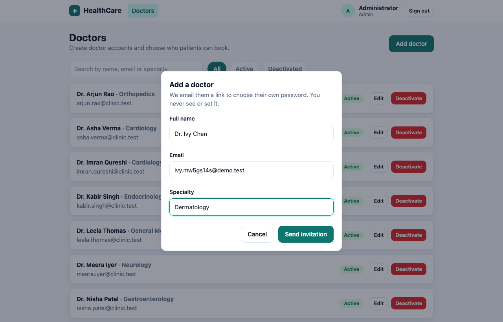
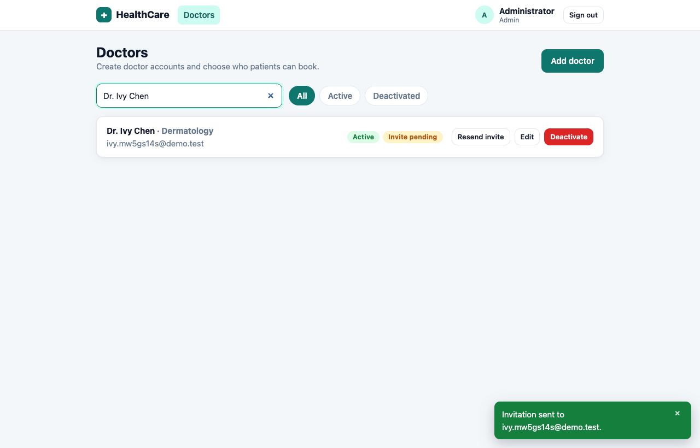

### 9. Doctor view
The invited doctor sets a password, signs in, and sees their own schedule (they can complete or cancel bookings).

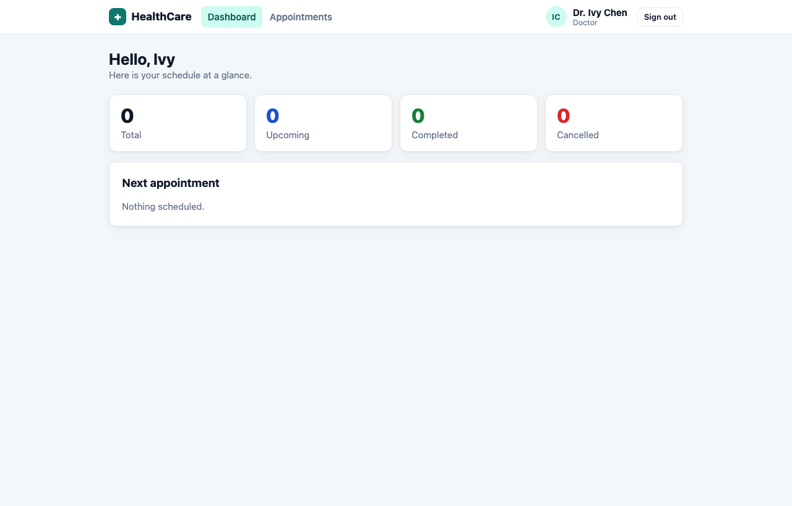

## Also in the app (not screenshotted)
Swagger UI at `/swagger-ui.html`, HTTPS with HSTS (`scripts/dev-cert.sh`), silent token refresh, and key rotation for encrypted data. See the README.
